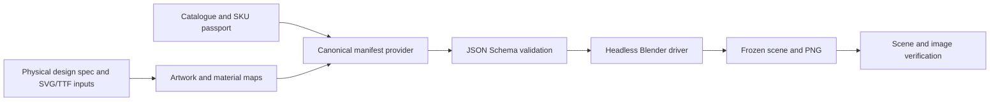
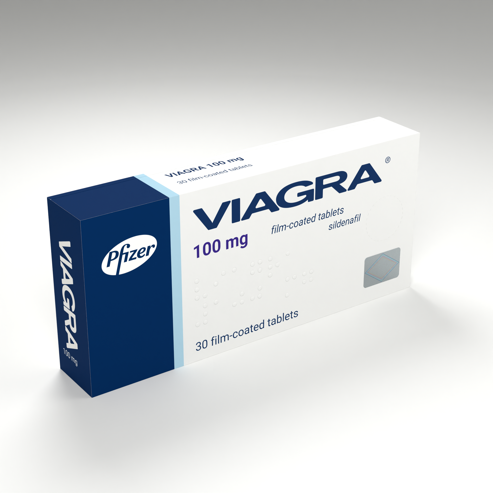
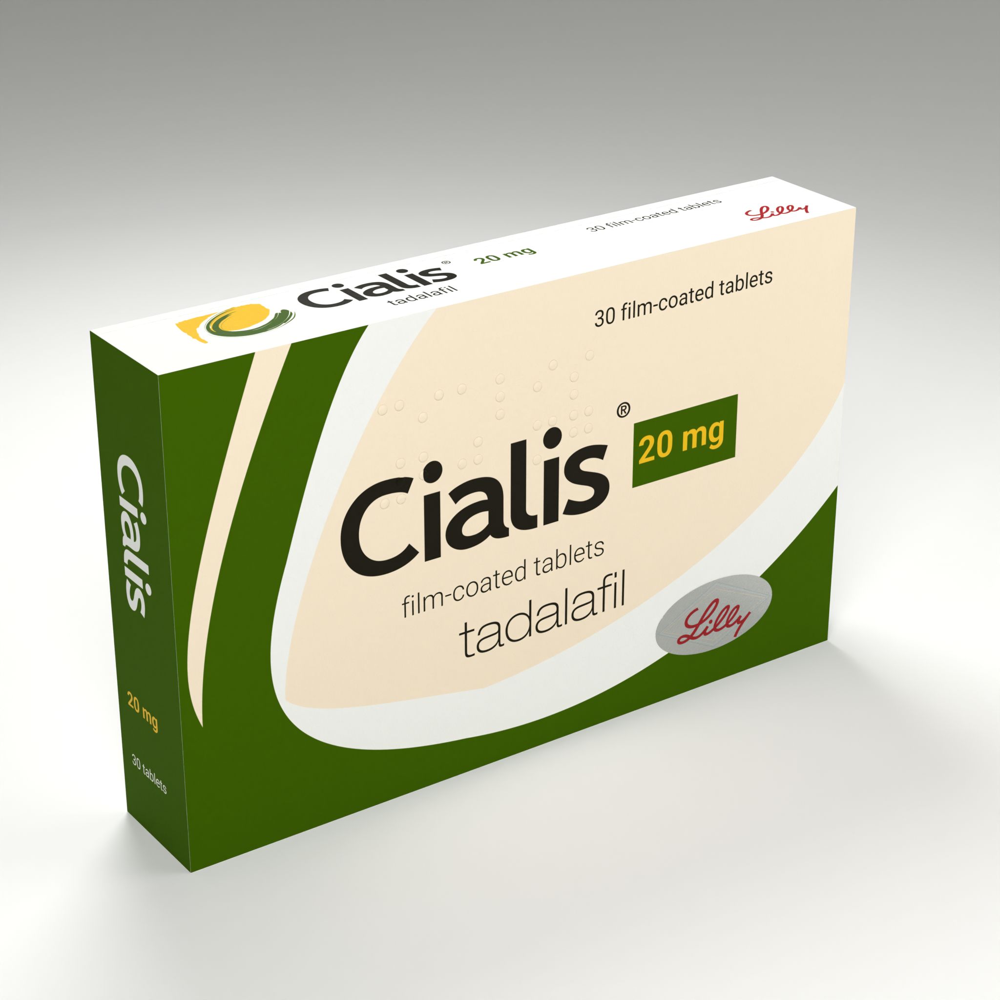

# Blender Farm Pro

## 1. Overview

**R&D prototype — two accepted packaging examples; further development discontinued due to project budget constraints.**

Blender Farm Pro is a PharmaGen PRO fork that explores controlled, headless Blender/Cycles rendering of pharmaceutical packaging. Its portfolio scope is **two owner-reported workplace-accepted examples**, Viagra (`74-min`) and Cialis (`59-min`). The retained catalogue contains 391 SKU records for legacy compatibility; it is not a claim of 391 visually approved products.

## 2. Problem Statement

Browser-based image generation did not provide sufficient control over packaging geometry, lighting, composition and printed elements. The engineering goal was a more inspectable Blender/Cycles process whose product text comes from SKU data and whose rendering decisions can be checked.

## 3. Engineering Approach

- Preserve SKU passports and one catalogue source of truth.
- Compile rendering instructions through the canonical manifest implementation and JSON Schema.
- Build physical geometry, independently sourced vector/font artwork and material maps.
- Render through one Blender driver, then inspect scene evidence and image results.
- Keep historical acceptance, numerical verification and production authenticity separate.

The unused photographic `reference_projection` experiment is excluded from this candidate. Physical rendering and the legacy geometry-based renderer remain supported; the physical-mode artwork/stage exceptions do not change legacy rules.

## 4. System Architecture



[Architecture and mode boundaries](docs/portfolio/ARCHITECTURE.md).

## 5. Blender/Cycles Rendering Pipeline

The physical builder generates an atlas from vendored fonts and independent SVG contours, creates the carton construction and relief, compiles manifest version `1.13`, and passes it to the existing Blender driver. One packed scene supplies the requested camera view. Geometry, UV, shader, camera and render evidence are recorded beside the output.

The physical demonstration command writes PNGs. The legacy Stage 3 WEBP contract is 1600×1600 and at most 500 KB; these 2048×2048 historical portfolio examples are not presented as Stage 3 deliverables.

## 6. Render Manifest & Data Contracts

- Contract: [`schemas/render_manifest.schema.json`](schemas/render_manifest.schema.json).
- Sole provider: [`src/render_manifest.py`](src/render_manifest.py).
- Template routing owner: `agent_1_router()` in [`src/passport_generator.py`](src/passport_generator.py).
- Catalogue: [`03_knowledge_graph/`](03_knowledge_graph/).

Versions `1.10`/`1.11` cover legacy geometry and compound marks; `1.13` covers the explicit physical branch. Experimental version `1.12` is retired. Consumers do not hand-build a second manifest contract.

## 7. Two Accepted Examples

### 74-min / Viagra



Owner-reported workplace acceptance. Original: `74-min-hero.png`, 2048×2048. Method: procedural carton, independent vector/font artwork, authored PBR approximation, relief and Cycles. The target is an authored 100 mg / 30-tablet adaptation, not a manufacturer-certified carton master. Exact historical creation commit is unknown.

### 59-min / Cialis



Owner-reported workplace acceptance. Original: `59-min-hero.png`, 2048×2048. Method: the same physical pipeline with Cialis artwork, foil approximation and Braille. The target is an authored 20 mg / 30-tablet adaptation. Its physical height estimate must not be mistaken for calibrated factory dimensions or the passport's printed dimensions.

These are **historically accepted render examples**. The WebP previews preserve every decoded RGBA pixel of the original PNGs. They are not substituted fresh renders. [Hashes and preview provenance](docs/portfolio/preview-provenance.json).

## 8. Technical Stack

Python 3.10; external Blender 5.1.2 / Cycles CPU; Pillow, NumPy, CairoSVG, fontTools, JSON Schema and PyYAML. Tests use stdlib `unittest`. Optional historical mark-measurement tooling declares its extra SciPy dependency in `requirements-measurement.txt`. Selenium/Gemini support is inherited legacy code and is not needed for the two physical demonstrations. No paid image-generation API is used by these commands.

## 9. Quality Assurance

Validation includes syntax compilation, schema/manifest generation, driver smoke checks, unit tests, clean-checkout checks, a controlled two-SKU render cycle, image/scene inspection and an independent review. Missing optional photography or slow integration resources are identified as **NOT VERIFIED**, not counted as successful checks. Local component errors must fail.

[Current test results](FINAL_TEST_RESULTS.md). Historical test counts are not reused as current results. The historical unresolved `R-004` flake is not declared fixed by one green run.

## 10. Verified Results

- The owner identified exactly the two examples above as accepted.
- Their original SHA-256 values match the preserved recovery evidence.
- The historical source archive and recorded closure artifact chain were hash-checked.
- Exact historical creation revisions remain unknown because rendering used uncommitted code.
- Reproduction equality and visual similarity are separate verdicts; see [provenance](ACCEPTED_RENDER_PROVENANCE.md) and [release report](FINAL_PORTFOLIO_RELEASE_REPORT.md).

## 11. Known Limitations

Only two packaging examples reached the stated visual acceptance. Remaining products were not completed due to budget constraints. Foil, surface roughness, optics and some dimensions are authored or estimated; production metrology and manufacturer approval are not established. DEMO barcode treatment and blank LOT/EXP fields must not be mistaken for production identifiers. No exact cross-version or cross-machine determinism is claimed. Direct whole-frame OCR on the hero views did not recover all brand/dose fields; human readability was inspected independently, and complete automated physical-view acceptance is not claimed.

The legacy catalogue, measurements and tests are engineering support data, not evidence that every SKU is approved. The 389 protected historical Gemini outputs remain tracked at the owner's request; they are not additional accepted portfolio examples. Historical documents and Git history may describe earlier scope.

## 12. My Contribution

I identified the image-quality problem, defined rendering requirements, designed the pipeline architecture, specified geometry/material/validation rules, coordinated AI-assisted implementation, evaluated render quality, and iteratively refined the visual results. This describes engineering direction and evaluation; it does not claim that I manually wrote all program code.

## 13. Installation & Reproduction

Use Python 3.10 and install the declared dependencies:

```powershell
git clone https://github.com/indexdeny/blender-farm-pro.git
cd blender-farm-pro
python -m pip install -r requirements.txt
```

CairoSVG also needs an available native Cairo library. Configure the external Blender executable in `config.yaml`; the checked environment used Blender 5.1.2. No system-font fallback is used. Check the [asset-rights and input ledger](docs/portfolio/ASSET_RIGHTS.md) before redistributing or using brand assets.

```powershell
python scripts/rebuild_carton.py --spec "Reference Templates/74_Viagra/design_spec.json" --views hero --output-root reports/demo-74 --output-stem 74-min-demo
python scripts/rebuild_carton.py --spec "Reference Templates/59_Cialis/design_spec.json" --views hero --output-root reports/demo-59 --output-stem 59-min-demo
python -m unittest discover -s tests -v
```

Outputs are `reports/demo-74/renders/74-min-demo.png` and `reports/demo-59/renders/59-min-demo.png`. Explicit physical output roots must be strictly inside this checkout's `reports` directory. Full-suite subprocesses generate temporary local artifacts; use a disposable clean checkout for verification. The catalogue render command is not required for this portfolio.

## 14. Project Status

**R&D prototype — two accepted packaging examples; further development discontinued due to project budget constraints.**

This release preparation is limited to preserving and presenting the two examples. Its validation/publication verdict is recorded in [PORTFOLIO_PUBLICATION_SUMMARY.md](PORTFOLIO_PUBLICATION_SUMMARY.md); an unverified local candidate must not be described as a published release.

## 15. Usage & Rights

The examples are independent R&D portfolio renderings, not officially certified packaging, manufacturer-supplied marketing assets or an endorsement by the named brands. Workplace acceptance is owner-reported and distinct from permission to publish. Brand names, marks, source vectors and fonts retain their respective rights. A public repository does not grant a blanket commercial or trademark licence.

Roboto is supplied with its OFL notice. Other brand-vector publication/redistribution permissions are tracked separately in [ASSET_RIGHTS.md](docs/portfolio/ASSET_RIGHTS.md). The owner confirmed permission for this portfolio publication. Permission instruments were not independently inspected, and no free or downstream commercial/trademark licence is implied.
